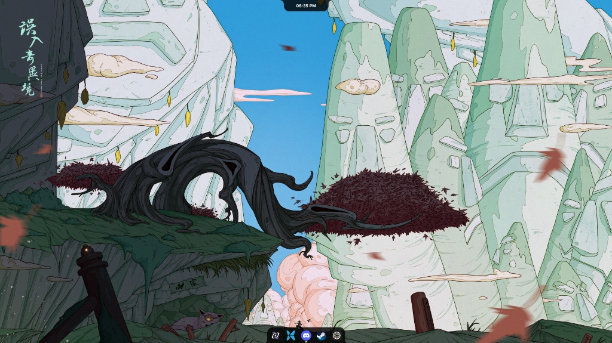
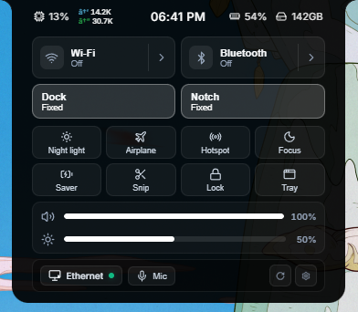
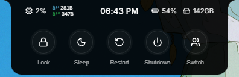
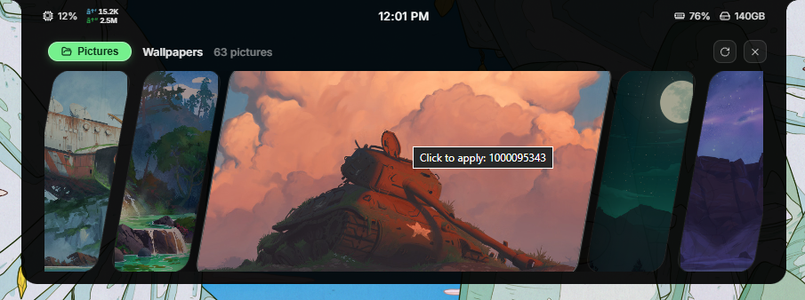
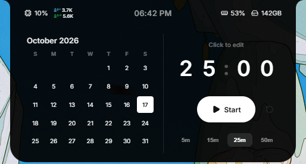
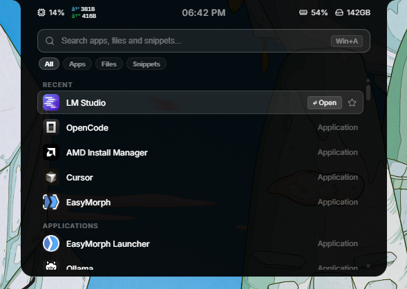
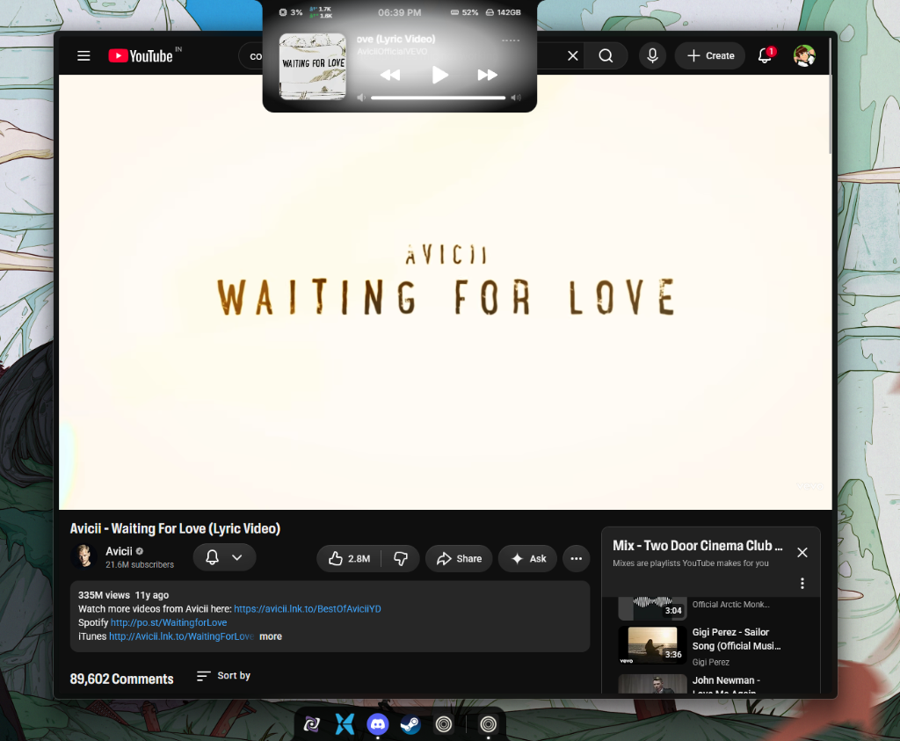
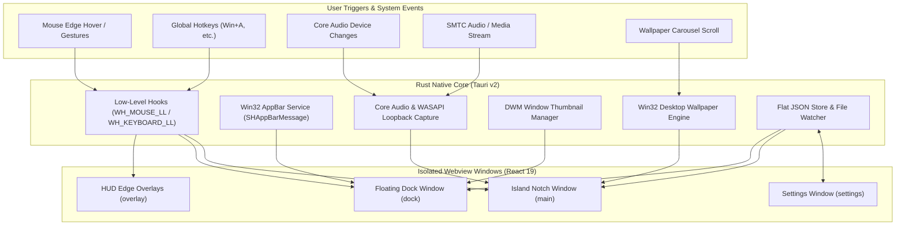

<div align="center">


# Orbix

**Dynamic Island Notch & Floating Physics Dock for Windows**

<p align="center">
  <em>An open-source, local-first desktop utility transforming the Windows desktop with spring-physics motion, an adaptive dynamic notch, and a customizable floating taskbar dock.</em>
</p>

[-0078D6?style=for-the-badge&logo=windows&logoColor=white)](https://www.microsoft.com/windows)
[](https://tauri.app/)
[](https://www.rust-lang.org/)
[](https://react.dev/)
[](https://www.framer.com/motion/)
[](https://learn.microsoft.com/en-us/windows/win32/coreaudio/core-audio-apis-in-windows-vista)
[-10B981?style=for-the-badge&logo=github&logoColor=white)](https://github.com/Lukog10/Orbix/releases/tag/v0.1.0)
[](LICENSE)

<br />

[Overview](#overview) &bull; [Core Features and Subsystems](#core-features-and-subsystems) &bull; [Visual Showcase](#visual-showcase) &bull; [System Architecture](#system-architecture) &bull; [Security and Windows Defender](#security-and-windows-defender) &bull; [Download](#download) &bull; [Building From Source](#building-from-source) &bull; [Repository Structure](#repository-structure) &bull; [License](#license)

<br />



</div>

---

## Overview

**Orbix** is a modern, physics-driven desktop replacement shell for Windows 10 and 11. Built with **Rust (Tauri v2)** and **React 19 / TypeScript**, Orbix replaces the traditional static Windows taskbar with a fluid, floating dock and introduces an adaptive, spring-animated island notch at the top of your display.

Every transition in Orbix is calculated via real-time physics simulations. Whether expanding the notch for quick system toggles, browsing high-resolution wallpapers in the panoramic carousel, triggering safe power actions, previewing running windows on the dock, controlling playback with live WASAPI audio visualizers, or managing Pomodoro focus sessions, Orbix delivers a refined, tactile computing experience without sacrificing performance or battery life.

### Why Orbix?

The standard Windows desktop shell has remained largely static for decades:
1. **Clunky Native Controls**: Quick toggles, power actions, and task switching require navigating separate flyouts, start menus, and hidden taskbar icons.
2. **Heavyweight Shell Replacements**: Many existing desktop customization tools consume substantial CPU and RAM, poll inefficiently, or trigger continuous GPU activity.
3. **Telemetry & Privacy Concerns**: Proprietary desktop enhancements often bundle analytics trackers, background telemetry agents, or forced online accounts.

**Orbix solves this with a modern, lightweight philosophy:**
- **Zero Telemetry & 100% Local**: No analytics pings, no cloud login, no external dependencies. All configuration is stored locally on your machine in clean JSON format.
- **Genuine Win32 Integration**: Uses native Win32 `AppBar` registration so maximized windows respect the dock layout, along with DWM thumbnail capture for fluid live previews.
- **Micro-Engineered Efficiency**: Rust-powered background workers sleep when idle. The WASAPI audio visualizer automatically suspends during playback pauses, and mouse-edge triggers dynamically relax outside interaction zones.
- **Natural Physics Animation**: Powered by Framer Motion springs and custom math curves, ensuring every gesture, hover, and dismiss feels alive.

---

## Core Features and Subsystems

Orbix is designed around five tightly integrated desktop subsystems:

### 1. The Island (Dynamic Top Notch)
An adaptive status island centered at the top of your monitor that smoothly expands, switches modes, and contracts based on user interaction:

<div align="center">
  
  <p><em>Command Center: Live telemetry, instant connectivity switches, and precision volume/brightness sliders.</em></p>
</div>

* **Live Hardware Telemetry**: Real-time meters for CPU utilization, RAM usage, storage availability, upstream/downstream network throughput, and battery capacity.
* **Command Center & Quick Controls**: Instant hardware switches for Wi-Fi, Bluetooth, Ethernet (with single-click toggle and right-click deep link to Windows Settings), Airplane Mode, Mobile Hotspot, Night Light, Focus / Do Not Disturb, and Energy Saver, alongside responsive sliders for master volume and display brightness.
* **Core Audio Device Detection**: Monitors connected input and output endpoints in real-time, displaying non-intrusive status pills when headphones or microphones are attached.

---

### 2. Notch Power Menu & Session Controls
A dedicated, tactile power drawer integrated directly into the top island notch:

<div align="center">
  
  <p><em>Power Menu: Rapid circular controls for Lock, Sleep, Restart, Shutdown, and User Switch.</em></p>
</div>

* **Instant Session Actions**: Circular controls for **Lock Workstation**, **Sleep**, **Restart**, **Shutdown**, and **Switch User**.
* **Accidental Click Protection**: Smooth hold-to-activate interaction prevents accidental shutdowns or reboots while interacting with the notch.
* **Persistent Top Telemetry**: Keeps critical system metrics (CPU load, active network throughput, battery percentage, remaining drive storage, and local time) visible above the power options.

---

### 3. Panoramic Wallpaper Carousel
A full-width, interactive wallpaper gallery embedded directly within the dynamic notch:

<div align="center">
  
  <p><em>Wallpaper Carousel: Smooth wheel-scroll gallery, folder picker, image count, and instant one-click desktop application.</em></p>
</div>

* **Fluid Wheel-Scroll Navigation**: Scroll horizontally across high-resolution wallpapers with realistic momentum physics, card tilting, and center-card zoom.
* **One-Click Wallpaper Switcher**: Click any wallpaper card to immediately apply it as your Windows desktop background via native Win32 `SystemParametersInfoW` APIs.
* **Directory & Folder Selector**: Quickly switch between default folders (`Pictures`, `Wallpapers`) or configure custom wallpaper directories with live image count badges (e.g., `63 pictures`).
* **Fast Caching & Performance**: Generates and caches lightweight thumbnail previews in the background, avoiding memory bloat and eliminating stutter.

---

### 4. Time, Focus & Application Search
<div align="center">
  <table>
    <tr>
      <td width="50%" align="center">
        
        <br /><strong>Calendar & Pomodoro Timer</strong>
      </td>
      <td width="50%" align="center">
        
        <br /><strong>Universal App & Snippet Search</strong>
      </td>
    </tr>
  </table>
</div>

* **Calendar & Focus Timer**: Split-view layout featuring a full interactive monthly calendar grid beside an integrated Pomodoro focus countdown timer (5m, 15m, 25m, 50m presets) with synthesized audio chimes upon completion.
* **Universal Search & Launcher (`Win+A`)**: Blazing-fast app launcher with keyboard indexing for installed applications, recent software, files, folders, and clipboard snippets.
* **The Shelf**: OLE drag-and-drop persistent staging dock for temporarily pinning files, images, documents, and text snippets while switching windows.

---

### 5. Media Player & WASAPI Audio Visualizer
<div align="center">
  
  <p><em>Island Media Player: Ambient glow album artwork, marquee track titles, media controls, and reactive audio visualizer.</em></p>
</div>

* **WASAPI Loopback Capture**: Captures system audio loopback without virtual audio drivers or latency, rendering real-time frequency-band visualizers with spring physics.
* **Rich Media Controller**: Reads metadata (title, artist, album art) from Windows System Media Transport Controls (SMTC) for Spotify, YouTube, Apple Music, and browsers.
* **Dynamic Ambient Glow**: Analyzes current album art colors to project a subtle ambient backdrop behind the floating notch.

---

### 6. The Floating Dock
A sleek, customizable taskbar replacement that hovers cleanly at the bottom of your workspace:

* **True Desktop Work-Area Management**: Hides the default Windows taskbar and registers genuine Win32 AppBars so full-screen and maximized windows adapt without awkward overlaps.
* **DWM Live Thumbnail Previews**: High-performance Desktop Window Manager (DWM) thumbnail rendering on icon hover.
* **Interactive Drag-and-Drop Reordering**: Smooth reordering of pinned items, running status dots, and instant removal of closed applications.
* **Display Modes**:
  - `Fixed`: Always reserved, persistent desktop presence.
  - `Smart`: Intelligently auto-hides when overlapped by active foreground windows.
  - `Peek`: Reveals instantly upon cursor contact with the screen bottom.

---

## Visual Showcase

| Quick Controls & Status | Power & Session Controls |
| :---: | :---: |
|  |  |
| **Panoramic Wallpaper Carousel** | **Adaptive Media Player** |
|  |  |
| **Focus & Calendar Hub** | **Instant Launcher (`Win+A`)** |
|  |  |

---

## System Architecture

Orbix employs a multi-webview Tauri v2 architecture that strictly isolates low-level Win32 hardware hooks in Rust while rendering ultra-responsive UI layers in React 19:



### Architectural Highlights
- **Multi-Window Isolation**: Four distinct webview contexts (`main`, `dock`, `overlay`, `settings`) prevent layout thrashing and maintain smooth 60+ FPS animations.
- **Win32 Hook Efficiency**: The global mouse hook (`WH_MOUSE_LL`) implements spatial early returns, relaxing CPU cycles whenever the cursor is outside hot zones.
- **Hardware Acceleration**: GPU-accelerated CSS transforms and Framer Motion spring physics ensure hardware-efficient rendering without tearing.

---

## Security and Windows Defender

Because Orbix integrates with low-level Windows shell APIs (managing the taskbar footprint via `SHAppBarMessage`, registering global shortcut hooks, and listening to WASAPI loopback audio), Windows Defender or SmartScreen may occasionally flag new builds upon initial download.

- **100% Open Source & Auditable**: Every line of Rust and TypeScript code is fully open source under the GPLv3 license.
- **Zero Network Egress**: Orbix contains no tracking code, telemetry SDKs, or background pings. All features run strictly on your device.
- **Build It Yourself**: You can verify and compile the entire application directly from source using standard tools (`cargo` and `bun`).

<details>
<summary>How to clear false-positive Windows Defender signatures</summary>

Open **Command Prompt as Administrator** and execute:

```cmd
cd "C:\Program Files\Windows Defender"
MpCmdRun.exe -removedefinitions -dynamicsignatures
MpCmdRun.exe -SignatureUpdate
```

</details>

---

## Download

### Standalone Executable (Windows x64)

Download the latest pre-built standalone release bundle:

- **[Latest Release: Orbix v0.1.0 (Beta)](https://github.com/Lukog10/Orbix/releases/tag/v0.1.0)**
- **[Direct Download: Orbix-v0.1.0-beta-windows-x64.zip](https://github.com/Lukog10/Orbix/releases/download/v0.1.0/Orbix-v0.1.0-beta-windows-x64.zip)**
- **[Direct Download: Standalone Orbix.exe](https://github.com/Lukog10/Orbix/releases/download/v0.1.0/Orbix.exe)**

#### Quick Installation
1. Download `Orbix-v0.1.0-beta-windows-x64.zip` or `Orbix.exe` from the release links above.
2. If using the ZIP, extract it to your preferred location (e.g. `C:\Program Files\Orbix` or your user folder).
3. Double-click **`Orbix.exe`** to launch immediately. No installer, third-party runtimes, or administrative privileges are required.
4. *(Optional)* Enable **Launch at Startup** in Orbix Settings to have your dock and notch start automatically with Windows.

---

## Building From Source

### Prerequisites
- **Operating System**: Windows 10 or 11 (64-bit)
- **Rust**: Stable toolchain ([rustup.rs](https://rustup.rs/))
- **Bun**: v1.4+ ([bun.sh](https://bun.sh/))
- **Node.js**: v18+ (optional, Bun handles all frontend scripting)

### Step-by-Step Instructions

```bash
# 1. Clone the repository
git clone https://github.com/Lukog10/Orbix.git
cd Orbix

# 2. Install frontend dependencies
bun install

# 3. Launch live development loop (Vite + Tauri Dev)
bun run tauri dev

# 4. Build optimized standalone production release
bun run build
cd src-tauri
cargo build --release --locked
```

The resulting standalone executable will be located at:
```
src-tauri/target/release/orbix.exe
```

---

## Repository Structure

```
Orbix/
├── assets/
│   └── screenshots/              # High-resolution screenshots and visuals
│       ├── orbix-desktop-hero.jpg        # Full-screen desktop showcase
│       ├── orbix-quick-settings.png      # Control Center and telemetry panel
│       ├── orbix-power-menu.png          # Power drawer and session actions
│       ├── orbix-wallpaper-carousel.png  # Panoramic wallpaper switcher
│       ├── orbix-calendar-timer.png      # Focus timer and calendar grid
│       ├── orbix-app-launcher.png        # Universal search and launcher
│       └── orbix-media-player.png        # Media notch and audio visualizer
├── docs/                         # Extended specifications and guides
├── public/                       # Static web icons and branding
├── scripts/                      # Release and version management automation
│   ├── bump-version.mjs          # Synchronized multi-file version bumper
│   └── release.mjs               # Automated git release pipeline
├── src/                          # React 19 Frontend Webview Components
│   ├── components/               # UI widgets (Notch, Calendar, Launcher, Shelf, Wallpaper)
│   ├── Dock.tsx                  # Floating dock implementation
│   ├── dockApps.ts               # Running app state & DWM thumbnail hooks
│   ├── Settings.tsx              # Comprehensive configuration window
│   └── main.tsx                  # Frontend entry point
├── src-tauri/                    # Rust Native Core & Win32 Integration
│   ├── src/                      # Win32 hooks, AppBar manager, Core Audio, Wallpaper engine
│   ├── Cargo.toml                # Rust crate definitions
│   └── tauri.conf.json           # Tauri multi-window and security config
├── SETTINGS.md                   # Flat JSON configuration specifications
└── LICENSE                       # GNU General Public License v3.0
```

---

## License

Orbix is licensed under the **[GNU General Public License v3.0 (GPLv3)](LICENSE)**.

---

<div align="center">

**Orbix &bull; Next-generation desktop dynamics for Windows.**

</div>
